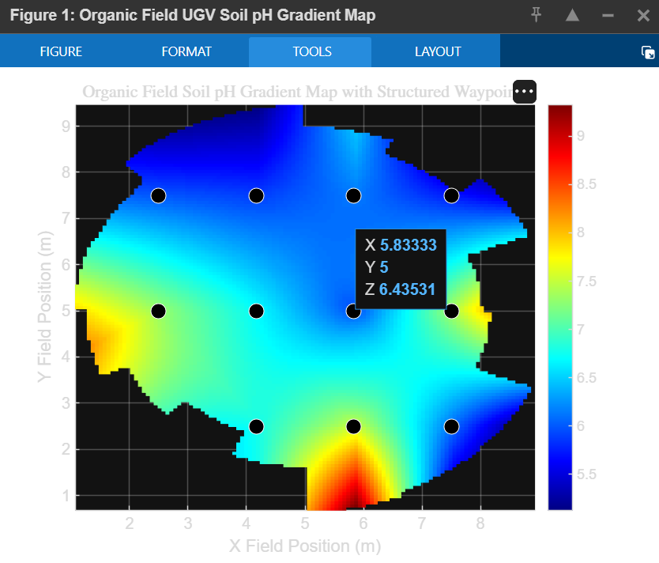
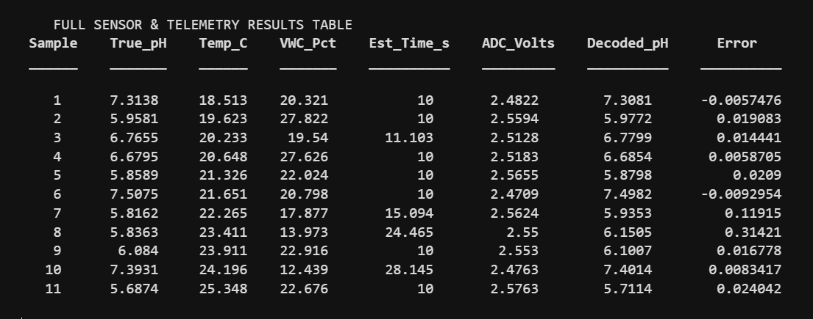
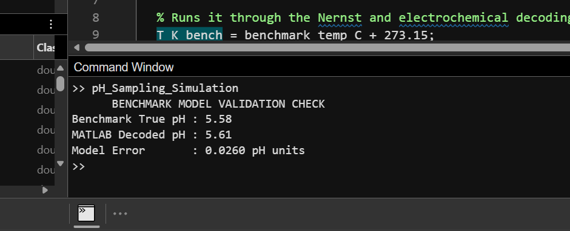

# pH_Simulation_Matlab

MATLAB simulation and validation scripts modeling temperature-compensated Nernst soil pH sensing, volumetric water content (VWC) response dynamics, boundary-filtered sampling points, 2D spatial pH interpolation, and benchmark validation.

## Simulation Visuals & Outputs

### Organic Field Soil pH Gradient Map

**What this shows:** An irregular field boundary generated over a `10m x 10m` workspace with structured sampling points plotted over a 2D interpolated soil pH map (`scatteredInterpolant` natural interpolation with nearest-neighbor fallback and boundary masking).

### Sensor & Telemetry Results Table

**What this shows:** Sample-by-sample simulation results from `Gradient_Interpolation.m`, including true pH, soil temperature (`Temp_C`), volumetric water content percentage (`VWC_Pct`), estimated settling time (`Est_Time_s`), ADC voltage (`ADC_Volts`), decoded pH (`Decoded_pH`), and pH error.

### Benchmark Model Validation Check

**What this shows:** Command Window output from `pH_Sampling_Simulation (1).m` evaluating a benchmark soil sample (`Benchmark True pH : 5.58`) through the Nernst and electrochemical decoding pipeline (`MATLAB Decoded pH : 5.61`, `Model Error : 0.0260 pH units`).

## Included Scripts
* **`Gradient_Interpolation.m`:** Generates a `10m x 10m` irregular field mask, filters structured sample coordinates inside the field boundary, simulates temperature-dependent Nernst potential and VWC-affected response dynamics, interpolates the 2D pH map, and prints position and sensor/telemetry tables.
* **`pH_Sampling_Simulation (1).m`:** Runs a benchmark soil sample through the Nernst and electrochemical decoding pipeline and logs the true pH, decoded pH, and model error in the Command Window.

## Key Technical Highlights
* **Boundary-Aware Sampling Grid:** Filters candidate coordinates against an angular-sector organic field mask so sample sites stay inside the valid region.
* **Nernst & Moisture Dynamics:** Accounts for temperature in the Nernst slope calculation and models moisture-driven settling/error behavior when VWC drops below `0.20`.
* **Spatial Interpolation & Masking:** Combines `'natural'` interpolation with `'nearest'` fallback and masks values outside the irregular field boundary.

## How to Run
1. Install **MATLAB** on your computer.
2. Clone or download this repository and open the project folder in MATLAB.
3. Run `Gradient_Interpolation.m` to generate the spatial pH gradient map and console tables, or run `pH_Sampling_Simulation (1).m` for the benchmark validation check.
